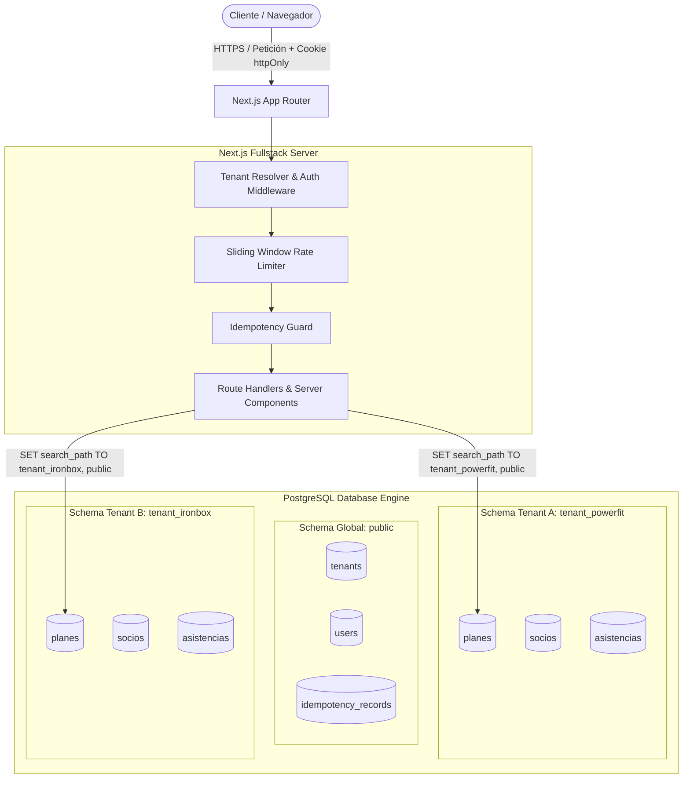

# 🏋️ FitSaaS — Plataforma SaaS Multitenant para Gimnasios y Estudios Fitness

Plataforma SaaS multitenant de alto rendimiento diseñada bajo el modelo **un schema por tenant en PostgreSQL**, con autenticación segura en cookies `httpOnly`, operaciones idempotentes garantizadas por clave, limitación de tasa por ventana deslizante (Rate Limiting) y recomendaciones ejecutivas con Inteligencia Artificial (Gemini).

---

## 📌 1. Nicho Elegido y Descripción del Dominio

* **Nicho:** Gimnasios, boxes de crossfit y centros de entrenamiento funcional.
* **Organización (Tenant):** Cada gimnasio registrado representa una organización independiente (ej. *PowerFit Gym*, *IronBox*, etc.).
* **Aislamiento:** Cada gimnasio opera en su propio esquema de PostgreSQL (`tenant_<slug>`), garantizando que jamás existan colisiones ni filtración de información entre gimnasios.

### Entidades del Dominio (3 entidades por tenant)
1. **Planes de Membresía (`planes`):** Catálogo de suscripciones con precio, vigencia en días y descripción (ej. Pase Diario, Membresía Mensual, Plan Trimestral VIP).
2. **Socios / Miembros (`socios`):** Información de atletas/clientes (nombre, documento de identidad, email, teléfono, plan asignado y estado: `activo` o `inactivo`).
3. **Control de Asistencias (`asistencias`):** Registro cronológico de acceso en recepción/torniquetes, validando en tiempo real que el socio pertenezca al gimnasio y tenga membresía activa.

---

## 🏛️ 2. Arquitectura Multitenant



### Organización de Schemas en PostgreSQL
* **Schema compartido (`public`):**
  * `tenants`: Registro global de gimnasios aprovisionados (`id`, `slug`, `name`, `schema_name`, `created_at`).
  * `users`: Cuentas de administradores asociadas a un tenant (`id`, `tenant_id`, `email`, `password_hash`, `role`).
  * `idempotency_records`: Registro centralizado de peticiones idempotentes y sus respuestas en caché con TTL de 24 horas scoped por `(tenant_id, endpoint, key)`.
* **Schema exclusivo (`tenant_<slug>`):**
  * Creado dinámicamente mediante `CREATE SCHEMA IF NOT EXISTS "tenant_<slug>"` al momento del registro.
  * Tablas de negocio: `planes`, `socios`, `asistencias`.

---

## 🔑 3. Resolución del Tenant en Cada Petición

La resolución se realiza de manera segura y transparente:
1. **Autenticación con JWT:** Tras el login o registro de un gimnasio, el servidor emite un JWT firmado que contiene:
   ```json
   {
     "userId": "uuid...",
     "email": "admin@powerfit.com",
     "tenantId": "uuid...",
     "tenantSlug": "powerfit",
     "tenantSchema": "tenant_powerfit"
   }
   ```
2. **Almacenamiento Seguro:** El token se guarda en una cookie `httpOnly` llamada `fit_session` (`SameSite: Lax`, protegida contra ataques XSS).
3. **Ejecución Scoped:** En cada Server Action, Route Handler o Server Component, la función `getSession()` extrae y valida el JWT.
4. **Conexión en Base de Datos:** Antes de ejecutar cualquier consulta de negocio, la conexión al pool ejecuta:
   ```sql
   SET search_path TO "tenant_powerfit", public;
   ```
   Al finalizar, el `search_path` se restablece a `public` antes de devolver la conexión al pool de PostgreSQL.

---

## ⚡ 4. Idempotencia y Rate Limiting

### 4.1 Idempotencia (Obligatorio)
* **Objetivo:** Evitar duplicación de registros por reintentos de red, caídas de conexión o doble clic en la interfaz.
* **Endpoints Protegidos:**
  * `POST /api/auth/register-tenant` (Creación de gimnasio y aprovisionamiento de schema).
  * `POST /api/socios` (Creación de socios).
  * `POST /api/asistencias` (Validación de acceso en torniquete).
* **Mecanismo:**
  * El cliente envía una clave única en el header `Idempotency-Key` (ej. UUID v4).
  * La clave se almacena scoped a `(tenant_id, endpoint, key)` con hash SHA-256 canónico (`stableStringify`).
  * Si la clave ya existe y el payload coincide, devuelve la respuesta almacenada sin volver a ejecutar la transacción (`X-Idempotent-Replay: true`).
  * Si la misma clave se reutiliza con un payload diferente, devuelve HTTP `422 Unprocessable Entity` (`idempotency_key_reused`).
  * **Persistencia y TTL:** Se conservan durante **24 horas** en la tabla global `idempotency_records`.

### 4.2 Rate Limiting (Obligatorio)
* **Algoritmo:** **Sliding Window Log (Ventana Deslizante)** en memoria/servidor.
* **Por qué esta elección:** Los algoritmos de ventana fija sufren del problema de ráfagas en los bordes del intervalo (doble cuota en el cambio de minuto). La ventana deslizante rastrea los timestamps exactos de las peticiones en un intervalo continuo de 60 segundos.
* **Límites Configurados:**
  * `/api/auth/login`: Máximo 5 intentos por minuto por IP.
  * Creación de recursos (`/api/socios`, `/api/asistencias`): Máximo 30-60 peticiones por minuto por tenant.
* **Respuesta ante Exceso:** Retorna código HTTP `429 Too Many Requests` con el header estándar `Retry-After: <segundos>` y cuerpo explicativo con cuenta regresiva.

---

## 🖥️ 5. Estrategias de Renderizado (Sección 4.9)

* **SSG (Static Site Generation):**
  * Página de Inicio (`/`): Pre-renderizada estáticamente en build-time con información pública del SaaS, rendimiento ultra rápido y cero carga en base de datos.
* **SSR (Server-Side Rendering):**
  * Panel Principal (`/dashboard`): Renderizado dinámico en el servidor en cada solicitud autenticada. Pre-carga métricas directamente desde el schema del tenant antes de enviar el HTML al navegador.
* **CSR (Client-Side Rendering):**
  * Formularios interactivos, filtros de búsqueda, modal de registro con Idempotency-Key y consola de inspección en vivo para la sustentación.

---

## 🚀 6. Cómo Levantar el Proyecto

### Opción A: Levantar todo con Docker Compose (Recomendado)
Levanta la base de datos PostgreSQL y la aplicación Next.js con un solo comando:

```bash
docker compose up -d --build
```
* **Aplicación Web:** `http://localhost:3001`
* **PostgreSQL:** `localhost:5436` (base de datos: `fitsaas_db`, usuario: `postgres`, password: `postgres`)

Para detener los contenedores:
```bash
docker compose down
```

---

### Opción B: Ejecución Local en Desarrollo

1. Levantar únicamente el contenedor de PostgreSQL:
   ```bash
   docker compose up -d postgres
   ```

2. Instalar dependencias:
   ```bash
   npm install
   ```

3. Configurar variables de entorno:
   ```bash
   cp .env.example .env
   ```

4. Ejecutar el servidor de desarrollo:
   ```bash
   npm run dev
   ```
   Abrir `http://localhost:3000` o `http://localhost:3001`.

---

## 🧪 7. Pruebas Automatizadas

El proyecto incluye una suite completa de pruebas automatizadas que valida 4 escenarios críticos:

```bash
npm test
```

Esta suite ejecuta:
1. **Inicialización:** Garantiza la creación de tablas globales en `public`.
2. **Aislamiento Multitenant Estricto:** Crea Tenant Alfa y Tenant Beta; comprueba que los socios insertados en Alfa no son visibles bajo ninguna circunstancia desde Beta (0 registros encontrados).
3. **Idempotencia Scoped por Tenant:** Comprueba que Tenant A y Tenant B usando la misma clave de idempotencia (`testKey`) en `/api/socios` reciben sus propias respuestas sin colisión.
4. **Replay Cacheado:** Comprueba que una segunda llamada con el mismo payload devuelva la respuesta cacheada sin re-ejecutar el handler (`X-Idempotent-Replay: true`).
5. **Detección de Reutilización de Clave:** Comprueba que reutilizar la misma clave con un payload distinto retorne de inmediato HTTP `422 Unprocessable Entity` (`idempotency_key_reused`).

---

## 🤖 8. Funcionalidades Adicionales (Puntos Extra)

* **Inteligencia Artificial con Google Gemini (+10 Pts):**
  * Endpoint `/api/ai/analytics` que analiza los socios y afluencia del gimnasio para generar un informe de retención y rentabilidad.
  * Modelo configurable mediante `GEMINI_MODEL` (por defecto `gemini-1.5-flash`).
  * Incluye memoria caché de 10 minutos para proteger la cuota gratuita y manejo tolerante a fallos si se alcanza el error 429 de Google.
* **Automatización con n8n (+10 Pts):**
  * Módulo `src/lib/webhooks.ts` que despacha eventos (ej. `tenant.created`) hacia un webhook configurable mediante `N8N_WEBHOOK_URL`.
* **Inspector para la Sustentación:**
  * Pestaña interactiva en el Dashboard para que el evaluador pueda disparar en vivo pruebas de idempotencia duplicada y saturación de rate limit (HTTP 429).

---

## 🌳 9. Estrategia de Ramas (Git Flow)

El desarrollo del proyecto sigue un flujo riguroso de integración continua:
* **`main`:** Rama protegida de producción. No admite commits directos; únicamente recibe Pull Requests aprobados que provienen de `develop`.
* **`develop`:** Rama principal de integración y staging donde confluyen todas las funcionalidades completadas y testeadas.
* **`feature/*`:** Ramas de trabajo efímeras creadas a partir de `develop` para aislar cada tarea (ej. `feature/p1.1-logout-endpoint`, `feature/p1.4-atomic-registration`, `feature/p1.2-zod-validation`).
* **Regla Inquebrantable:** Cada Pull Request hacia `develop` o `main` debe superar obligatoriamente el pipeline de GitHub Actions CI (`npm run lint`, pruebas de aislamiento `npm test`, y `next build`).

---

## ⚖️ 10. Limitaciones Conocidas (Trade-offs de Diseño)

Durante la auditoría y desarrollo se tomaron decisiones arquitectónicas con trade-offs conscientes:

1. **Rate Limiting en Memoria (Sliding Window Log):**
   * *Estado:* Implementado eficientemente en memoria Node.js para despliegues de instancia única.
   * *Trade-off:* En un entorno multi-instancia horizontal (cluster), los contadores no se comparten entre réplicas. Para escalar horizontalmente se requeriría un almacén distribuido como Redis.
2. **Idempotencia Secuencial vs Concurrente:**
   * *Estado:* Protege de manera integral contra reintentos de red, reenvíos y caídas secuenciales mediante persistencia en `public.idempotency_records` con hash canónico SHA-256 (`stableStringify`) y detección de reutilización con payload diferente (HTTP 422).
   * *Trade-off:* Si dos peticiones idénticas llegan en el microsegundo exacto en paralelo, ambas podrían superar el chequeo inicial antes de que la primera inserte en la tabla (carrera concurrente). Esto se documenta como limitación aceptada sin claim optimista `processing`.
3. **Control Nativo con `pg` en lugar de un ORM (Prisma / Drizzle):**
   * *Estado:* Uso deliberado del driver nativo `node-postgres` (`pg`).
   * *Justificación:* Prisma y otros ORMs requieren pre-generar o instanciar clientes cacheados por cada esquema dinámico en runtime. `pg` permite ejecutar de forma determinista y sin sobrecosto de memoria comandos como `SET search_path` y `SET LOCAL search_path` por conexión.
4. **Confianza de IP en `X-Forwarded-For`:**
   * *Estado:* El limitador de tasa y registro extraen la IP del cliente de `x-forwarded-for`.
   * *Supuesto Operativo:* En producción se asume la presencia de un Reverse Proxy confiable (Nginx, Traefik, Cloudflare) que sanitiza y reescribe las cabeceras `X-Forwarded-For` y `X-Real-IP`, previniendo spoofing.
5. **Aprovisionamiento Atómico:**
   * *Garantía:* Toda la creación del tenant (`CREATE SCHEMA`, `CREATE TABLEs`, inserción en `public.tenants` y `public.users`) se ejecuta en una única transacción con `SET LOCAL search_path`. Ante cualquier error, el `ROLLBACK` total garantiza cero schemas huérfanos.

---

## 🚀 11. Despliegue en VPS (Producción con Docker & Nginx)

La arquitectura de producción está contenerizada y orquestada para garantizar alta disponibilidad y seguridad:

* **PostgreSQL:** Corre en una red interna de Docker (`fitsaas_prod_network`) **sin exponer el puerto 5432 al exterior**, evitando ataques de fuerza bruta directos a la base de datos.
* **Next.js:** Empaquetado en un contenedor optimizado en modo `NODE_ENV=production` con reinicio automático (`restart: unless-stopped`).
* **Nginx:** Actúa como Proxy Inverso en los puertos 80 (HTTP) y 443 (HTTPS), gestionando la terminación del tráfico, cabeceras `X-Forwarded-*` y reenviando al puerto 3000 de la app.

### Pasos para desplegar en tu servidor VPS (Ubuntu / Debian / AlmaLinux):

1. **Clonar el repositorio en la VPS:**
   ```bash
   git clone https://github.com/escamilladaniel28-cpu/fitsaas-multitenant.git
   cd fitsaas-multitenant
   ```

2. **Crear el archivo de variables de entorno de producción:**
   ```bash
   cp .env.production.example .env.production
   nano .env.production
   ```
   *Genera contraseñas fuertes para `POSTGRES_PASSWORD` y un secreto criptográfico para `JWT_SECRET` (puedes crearlo con `openssl rand -base64 32`).*

3. **Construir y levantar los contenedores:**
   ```bash
   docker compose --env-file .env.production -f docker-compose.prod.yml up -d --build
   ```

4. **Verificar el estado y los logs del servicio:**
   ```bash
   # Comprobar contenedores activos y saludables
   docker compose -f docker-compose.prod.yml ps

   # Ver logs en tiempo real
   docker compose -f docker-compose.prod.yml logs -f web
   docker compose -f docker-compose.prod.yml logs -f nginx
   ```

5. **(Opcional) Configurar Certificado SSL Gratuito con Certbot:**
   Para habilitar HTTPS en el puerto 443 con Let's Encrypt:
   ```bash
   sudo certbot --nginx -d tu-dominio.com
   ```

